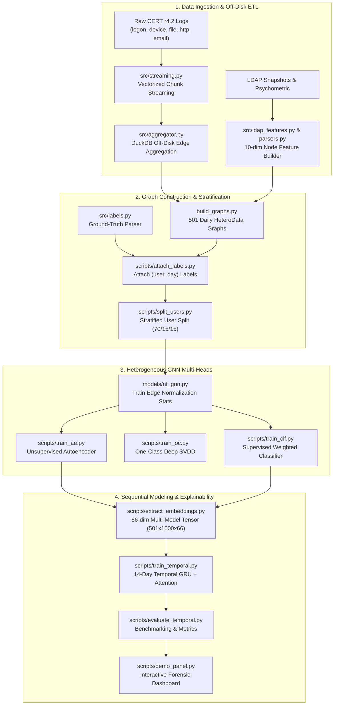

# Insider Threat Detection via Temporal Heterogeneous Graph Neural Networks

> **Project Executive Summary & System Architecture Reference**  
> *Dataset: CMU CERT Insider Threat Testbed (r4.2) | Scope: 1,000 Employees across 501 Calendar Days (Jan 2010 – May 2011)*

---

## 1. Executive Summary

Insider threats—ranging from intellectual property theft and unauthorized data exfiltration to IT sabotage—are notoriously difficult to detect with traditional Security Information and Event Management (SIEM) correlation rules or shallow machine learning models. Traditional methods suffer from high false-positive fatigue and fail to capture complex, multi-relational interactions that evolve subtly over time.

This project implements an end-to-end deep learning framework that couples **Heterogeneous Graph Neural Networks (HeteroGNN)** with a **Sequential Temporal Attention GRU** to detect malicious insider activity under extreme class imbalance (~1:500 malicious-to-benign user-day ratio).

### Key Architectural Highlights
1. **Multi-Relational Daily Graphs**: Replaces flattened feature vectors with daily heterogeneous bipartite graphs modeling interactions between users, workstations, and external domains across six distinct enterprise activity streams.
2. **Multi-Paradigm Representation Learning**: Evaluates and combines three distinct paradigms:
   - **Unsupervised Graph Autoencoder ([`InsiderThreatAE`](file:///Users/vivek/Projects/insider_gnn/models/heads.py#L13-L52))**: Reconstructs normal graph topologies and feature distributions to flag zero-day anomalies without labels.
   - **One-Class Deep SVDD ([`InsiderThreatOC`](file:///Users/vivek/Projects/insider_gnn/models/heads.py#L55-L77))**: Encloses normal behaviors in a latent hypersphere.
   - **Supervised Classifier ([`InsiderThreatCLF`](file:///Users/vivek/Projects/insider_gnn/models/heads.py#L80-L97))**: Employs class-weighted optimization for known attack signatures.
3. **Temporal Attention Modeling ([`TemporalGRU`](file:///Users/vivek/Projects/insider_gnn/models/temporal.py#L14-L83))**: Ingests rolling 14-day sequences of multi-model embeddings (64-dim GNN latent space + 1-dim AE reconstruction error + 1-dim static threat probability), using self-attention pooling to detect multi-stage attack escalation.
4. **Analyst Explainability & Forensics**: Deconstructs flagged alerts into **Relational Activity Contributions** (identifying specific malicious edge types like USB insertion or bulk file copy) and **14-Day Temporal Attention Heatmaps** (identifying the exact escalation timeline).

---

## 2. Benchmark Results & Quantitative Evaluation

All models were evaluated on **150 strictly held-out test users** (75,150 user-days; 73,200 valid rolling evaluation instances). Because insider threat detection is an extreme needle-in-a-haystack problem, **PR-AUC (Precision-Recall AUC)** and **Precision@K (P@K)** serve as primary metrics rather than misleading accuracy or ROC-AUC scores.

### Comparative Performance Table

| Model Paradigm | Architecture | PR-AUC | ROC-AUC | Multiplier vs. Chance | P@10 | P@20 | P@50 | P@100 |
| :--- | :--- | :---: | :---: | :---: | :---: | :---: | :---: | :---: |
| **Unsupervised Zero-Day** | [`InsiderThreatAE`](file:///Users/vivek/Projects/insider_gnn/models/heads.py#L13-L52) | 0.0128 | 0.8905 | 6.1x | 0.0% | 5.0% | 4.0% | 3.0% |
| **One-Class Boundary** | [`InsiderThreatOC`](file:///Users/vivek/Projects/insider_gnn/models/heads.py#L55-L77) | 0.0066 | 0.6861 | 3.2x | 0.0% | 0.0% | 0.0% | 0.0% |
| **Static GNN Snapshot** | [`InsiderThreatCLF`](file:///Users/vivek/Projects/insider_gnn/models/heads.py#L80-L97) | 0.2146 | 0.9875 | 102.1x | 40.0% | 40.0% | 30.0% | 26.0% |
| **Sequential Temporal (Ours)** | [`TemporalGRU`](file:///Users/vivek/Projects/insider_gnn/models/temporal.py#L14-L83) | **0.5620** | **0.9936** | **260.4x** | **100.0%** | **100.0%** | **82.0%** | **67.0%** |

> [!IMPORTANT]
> The **Temporal GRU achieves 100% precision among the top 10 and top 20 flagged analyst alerts (P@10 = 100%, P@20 = 100%)**, representing a massive reduction in triage noise compared to single-day static evaluation.

---

## 3. High-Level System Architecture



---

## 4. Pipeline Component Breakdown

### 4.1 Data Pipeline & Off-Disk Processing
- **Source Data**: Carnegie Mellon University CERT r4.2 Insider Threat Dataset (16+ GB raw CSVs).
- **Chunked Streaming ([`src/streaming.py`](file:///Users/vivek/Projects/insider_gnn/src/streaming.py))**: Large sources (`http.csv`, `email.csv`) exceed RAM; chunk-streamed using vectorized Pandas and typed schema mapping.
- **DuckDB Aggregation ([`src/aggregator.py`](file:///Users/vivek/Projects/insider_gnn/src/aggregator.py))**: Off-disk SQL aggregation computes daily activity frequencies, session durations, after-hours usage, and file sizes.
- **Node Features ([`src/ldap_features.py`](file:///Users/vivek/Projects/insider_gnn/src/ldap_features.py), [`src/parsers.py`](file:///Users/vivek/Projects/insider_gnn/src/parsers.py))**:
  - `user` node: 10 features = 5 OCEAN Big-Five psychometric personality traits + 5 monthly LDAP organizational attributes (role encoding, department encoding, tenure days, management depth, supervisor link).
  - `pc` node: Shared workstations.
  - `domain` node: Internal vs. external destination web/email targets.
- **Edge Schema ([`src/schema.py`](file:///Users/vivek/Projects/insider_gnn/src/schema.py), [`src/graph_builder.py`](file:///Users/vivek/Projects/insider_gnn/src/graph_builder.py))**:
  - `('user', 'logs_into', 'pc')`
  - `('user', 'uses_pc', 'pc')`
  - `('user', 'uses_device', 'pc')`
  - `('user', 'copies_file', 'pc')`
  - `('user', 'sends_email', 'domain')`
  - `('user', 'visits_url', 'domain')`

### 4.2 Data Leakage Prevention & Stratification
- **Zero Behavioral Leakage ([`scripts/split_users.py`](file:///Users/vivek/Projects/insider_gnn/scripts/split_users.py))**:
  - Splitting by calendar date leaks a user's normal baseline into future test days.
  - The project splits **by User ID**: 700 Train users, 150 Validation users, and 150 Test users.
  - Stratified by malicious incidence (proportional allocation of the 70 confirmed malicious actors).
- **Train-Only Edge Normalization ([`models/nf_gnn.py:compute_train_edge_norm_stats`](file:///Users/vivek/Projects/insider_gnn/models/nf_gnn.py#L327-L360))**:
  - Per-relation z-score normalization statistics are calculated **exclusively** on edges originating from train-split users to eliminate inductive test leakage.

### 4.3 Heterogeneous Graph Representation
- **Graph Encoder ([`models/nf_gnn.py:HeteroGNNEncoder`](file:///Users/vivek/Projects/insider_gnn/models/nf_gnn.py#L182-L248))**:
  - Projects heterogeneous node feature dimensions to 64-dim latent space.
  - Uses PyG relational message-passing layers conditioned on multi-dimensional edge attribute vectors.
  - Applies `ToUndirected()` transformations to ensure reverse message flow across bipartite edges.
- **Heads ([`models/heads.py`](file:///Users/vivek/Projects/insider_gnn/models/heads.py))**:
  - [`InsiderThreatAE`](file:///Users/vivek/Projects/insider_gnn/models/heads.py#L13-L52): Decoder reconstructs user node attributes and incident edge attributes. Error = Mean Squared Error (MSE).
  - [`InsiderThreatOC`](file:///Users/vivek/Projects/insider_gnn/models/heads.py#L55-L77): Projects user embeddings into single-sphere representation space; anomaly score = distance to centroid $c$.
  - [`InsiderThreatCLF`](file:///Users/vivek/Projects/insider_gnn/models/heads.py#L80-L97): Linear classification projection with positive-class weighting ($\text{pos\_weight} \approx 500$).

### 4.4 Temporal Sequential Modeling
- **Feature Extraction ([`scripts/extract_embeddings.py`](file:///Users/vivek/Projects/insider_gnn/scripts/extract_embeddings.py))**:
  - Daily heterogeneous inference creates a compact $[501 \text{ days} \times 1,000 \text{ users} \times 66 \text{ features}]$ tensor.
  - Features per user-day: 64 structural GNN dimensions + 1 unsupervised AE reconstruction error + 1 supervised static risk probability.
- **Sequential Attention Architecture ([`models/temporal.py:TemporalGRU`](file:///Users/vivek/Projects/insider_gnn/models/temporal.py#L14-L83))**:
  - 2-layer GRU with hidden dimension 64 and dropout 0.3.
  - **Self-Attention Pooling**: Learns attention weights across the 14-day window:
    $$\alpha_t = \frac{\exp(w^T \tanh(W_a h_t))}{\sum_{\tau=1}^W \exp(w^T \tanh(W_a h_\tau))}$$
  - Weighted context vector $c = \sum_{t=1}^W \alpha_t h_t$ feeds into the final sigmoid risk prediction layer.

---

## 5. Explainability & Forensic Case Study

The system provides root-cause explainability across two complementary axes:

### Axis 1: Relational Activity Breakdown (Edge Attribution)
Deconstructs a user's deviation score on a flagged day into specific operational categories:
- **File Transfers (`copies_file`)**: Bulk copying, sensitive file access.
- **Removable Media (`uses_device`)**: Unauthorized USB flash drives.
- **Web Browsing (`visits_url`)**: Visiting wikileaks, competitor domains, cloud uploaders.
- **Email Transmission (`sends_email`)**: Exfiltration via personal email.
- **Authentication (`logs_into`, `uses_pc`)**: Off-hours or unauthorized workstation usage.

### Axis 2: 14-Day Temporal Attention Heatmap
Highlights how risk accumulated over the 14-day attack window:
- Normal routine preceding an attack receives near-zero attention ($< 1\%$).
- Attack reconnaissance, USB insertion, and final bulk exfiltration days capture escalating attention shares (up to $27.7\%$ on execution day).

---

## 6. Directory Layout & Key File Map

```
insider_gnn/
├── build_graphs.py                # End-to-end graph builder: raw logs -> daily HeteroData
├── requirements.txt               # Python package dependencies
├── configs/                       # Project configuration files
├── data/                          # [Gitignored]
│   ├── raw/                       # CERT r4.2 raw logs (logon, device, file, http, email, psychometric)
│   ├── interim/                   # Streamed intermediate event files
│   └── processed/                 # user_splits.json, user_day_labels.csv, ldap_features.csv
├── models/                        # Deep learning architecture definitions
│   ├── __init__.py                # Package exports
│   ├── nf_gnn.py                  # HeteroGNNEncoder, graph normalization, split masking
│   ├── heads.py                   # AE, OC, and CLF task heads
│   └── temporal.py                # TemporalGRU with Self-Attention pooling
├── output/                        # [Gitignored]
│   ├── checkpoints/               # Trained models: ae_best.pt, clf_best.pt, temporal_best.pt
│   ├── reports/                   # Benchmarks: model_comparison_report.json, temporal_evaluation_report.json
│   ├── aggregated_edges.csv       # DuckDB multi-source edge table
│   ├── daily_graphs_labeled.pkl   # 501 labeled PyG HeteroData graphs
│   ├── edge_norm_stats.pt         # Train-split edge normalization parameters
│   └── temporal_features.pt       # Pre-extracted 66-dim embeddings tensor
├── scripts/                       # Training, evaluation, and operational CLI scripts
│   ├── attach_labels.py           # Attaches ground truth (user, day) labels to graph objects
│   ├── split_users.py             # Stratified user split generator (70/15/15)
│   ├── train_ae.py                # Unsupervised Autoencoder training
│   ├── train_oc.py                # One-Class Deep SVDD training
│   ├── train_clf.py               # Supervised Classifier training
│   ├── evaluate_comparison.py     # Side-by-side evaluation of static heads
│   ├── extract_embeddings.py      # Feature extraction across 501 days
│   ├── train_temporal.py          # 14-day Temporal GRU training
│   ├── evaluate_temporal.py       # Temporal evaluation & ranking metrics
│   └── demo_panel.py              # Interactive terminal benchmark & forensic demonstration
└── src/                           # Low-level parsing and ETL utilities
    ├── aggregator.py              # DuckDB-powered edge aggregator
    ├── graph_builder.py           # PyG HeteroData construction
    ├── labels.py                  # Ground truth answer parser
    ├── ldap_features.py           # Monthly LDAP organization parser
    ├── parsers.py                 # Small-source CSV parsers
    ├── schema.py                  # Pydantic / DataFrame schemas
    └── streaming.py               # Vectorized chunk streaming for HTTP and Email
```

---

## 7. How to Reproduce & Run

### Quick Demo Run (If Precomputed Artifacts Exist)
```bash
python scripts/demo_panel.py
```

### Full Retraining Pipeline (From Raw CERT Logs)
```bash
# 1. Parse answers into ground-truth labels
python src/labels.py

# 2. Build 501 daily heterogeneous graphs
python build_graphs.py

# 3. Attach labels & generate stratified splits
python scripts/attach_labels.py
python scripts/split_users.py

# 4. Compute edge normalization statistics
python -c "import pickle, torch; from models import compute_train_edge_norm_stats, load_user_split_masks; graphs = pickle.load(open('output/daily_graphs_labeled.pkl', 'rb')); masks = load_user_split_masks(); torch.save(compute_train_edge_norm_stats(graphs, masks['train']), 'output/edge_norm_stats.pt')"

# 5. Train baseline heads
python scripts/train_ae.py
python scripts/train_oc.py
python scripts/train_clf.py

# 6. Evaluate static baselines
python scripts/evaluate_comparison.py

# 7. Extract multi-model embeddings & train temporal model
python scripts/extract_embeddings.py
python scripts/train_temporal.py
python scripts/evaluate_temporal.py

# 8. Launch terminal demonstration panel
python scripts/demo_panel.py

# 9. Compile SOC Dataset & launch Headless REST API Server for UI/Designers
python scripts/export_soc_data.py
python scripts/soc_server.py --port 8080
# API discovery endpoint: http://localhost:8080/ (See docs/DESIGNER_INTEGRATION_GUIDE.md)
```


